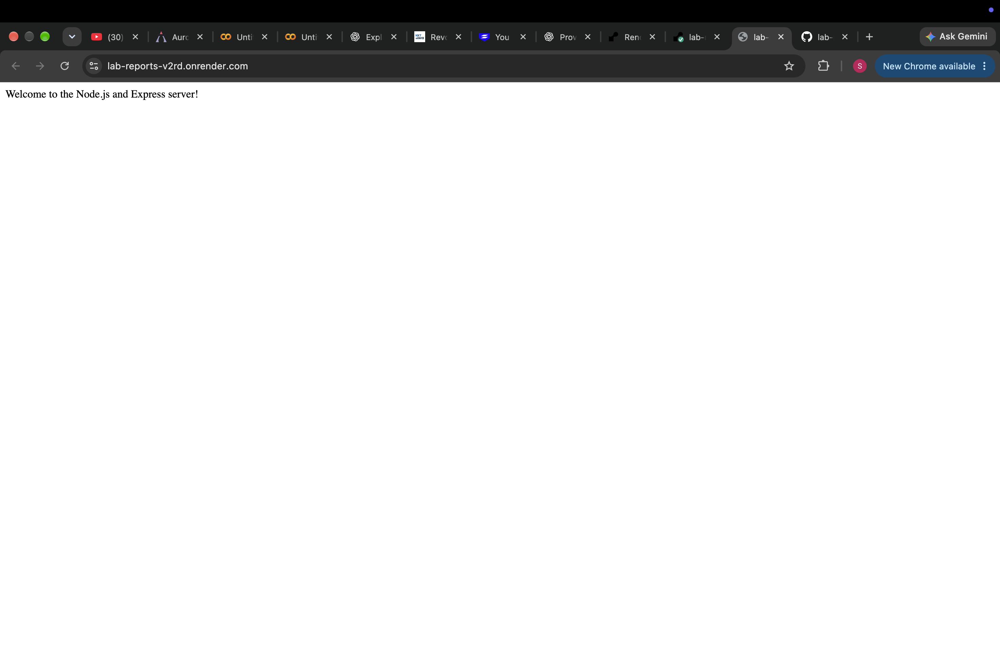
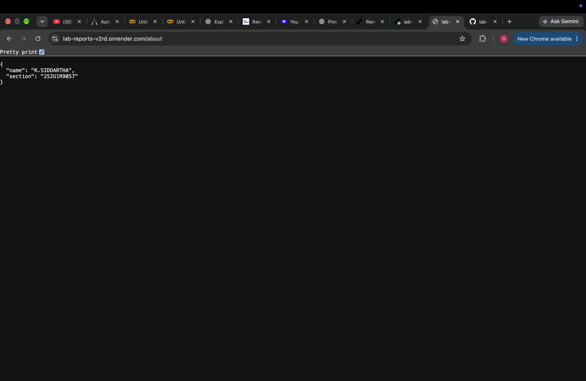
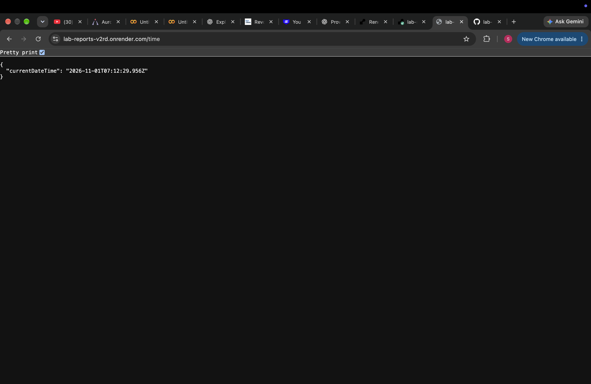
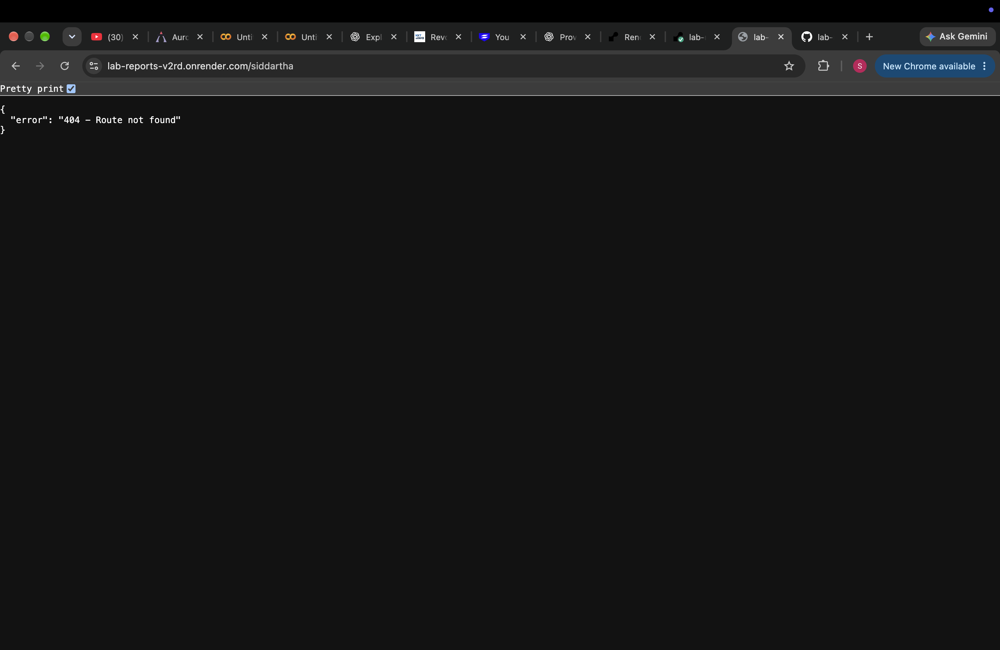

# Lab 1: Node.js and Express server

**Name:** K.SIDDARTHA
**Registration number:** 252U1R9057
**Section:** CSE-GEN-AI-2A

## Live link

https://lab-reports-v2rd.onrender.com/

## Objective

Create a basic Node.js HTTP server, rewrite it using Express, and add routes with appropriate status codes.

## Requirements

- Node.js and npm installed
- Express installed through npm

## How to run

1. Open a terminal in this folder.
2. Install dependencies:

   ```bash
   npm install
   ```

3. Start the server:

   ```bash
   npm start
   ```

4. Open the endpoints below in your browser.

## Endpoints

| Method | Path             | Description                      | Expected status |
| ------ | ---------------- | -------------------------------- | --------------- |
| GET    | `/`              | Welcome text                     | 200             |
| GET    | `/about`         | JSON containing name and section | 200             |
| GET    | `/time`          | Current date and time            | 200             |
| GET    | Any unknown path | JSON 404 message                 | 404             |

Base URL while running locally: `http://localhost:3000`

## Plain Node.js HTTP server

The `http-server.js` file demonstrates the built-in `http` module and responds with `Hello`.

Run it separately with:

```bash
node http-server.js
```

Stop one server with `Ctrl+C` before starting the other, because both use port 3000 by default.

## Screenshots

Add screenshots of `/`, `/about`, `/time`, and an unknown route inside a `screenshots/` folder. Then include them here, for example:

```markdown




```

## `package.json` fields

- `name`: project/package name.
- `version`: project version.
- `description`: short project summary.
- `main`: entry JavaScript file.
- `scripts`: shortcut commands such as `npm start`.
- `keywords`: searchable labels.
- `author`: package author.
- `license`: package license.

## Viva preparation

- **`package.json` vs `node_modules`:** `package.json` records project metadata and dependencies; `node_modules` contains the installed package code.
- **What does `app.listen()` do?** Starts the Express server and makes it listen for requests on the selected port.
- **What are `req` and `res`?** `req` contains information about the incoming request; `res` is used to send a response.

## Notes

Replace the placeholder name, registration number, and section with your details. Capture your own screenshots and add your deployment URL before submission.
# lab-reports
