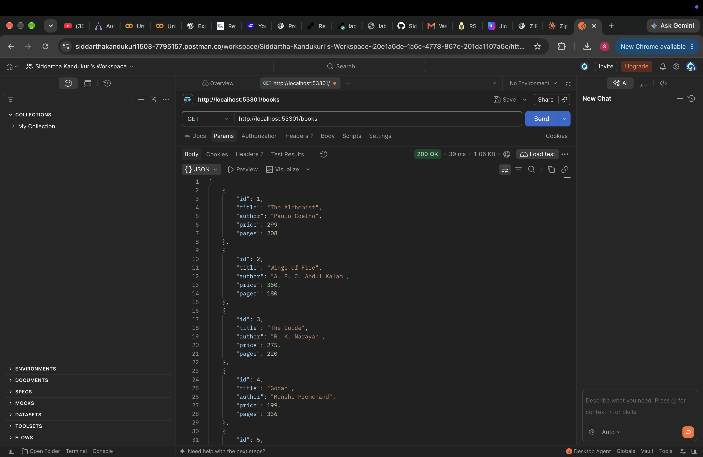
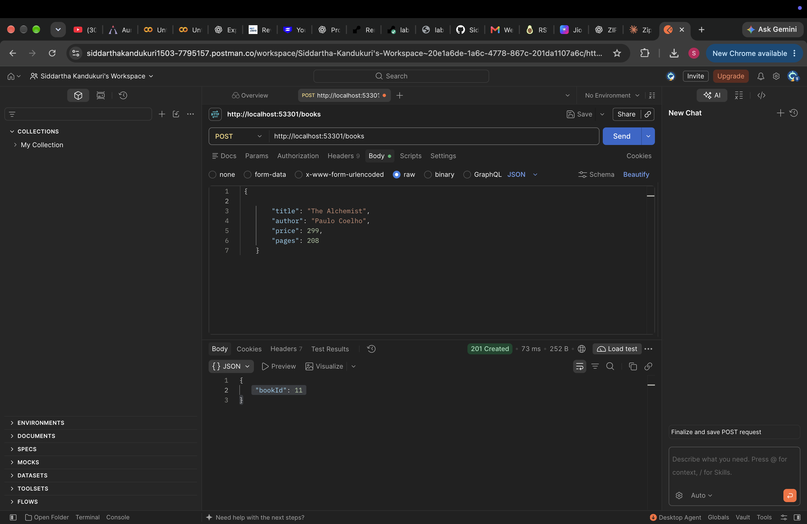
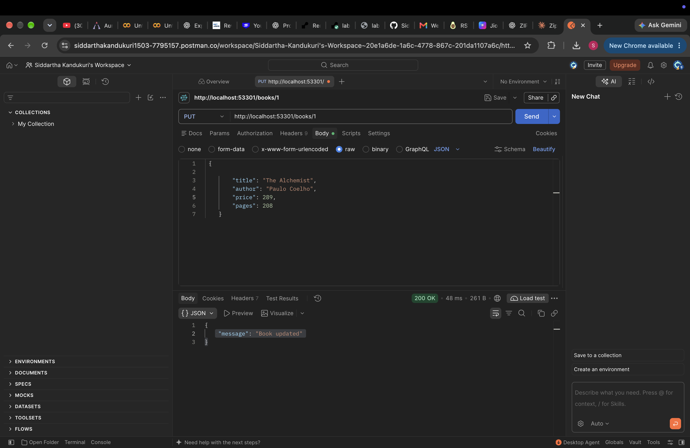
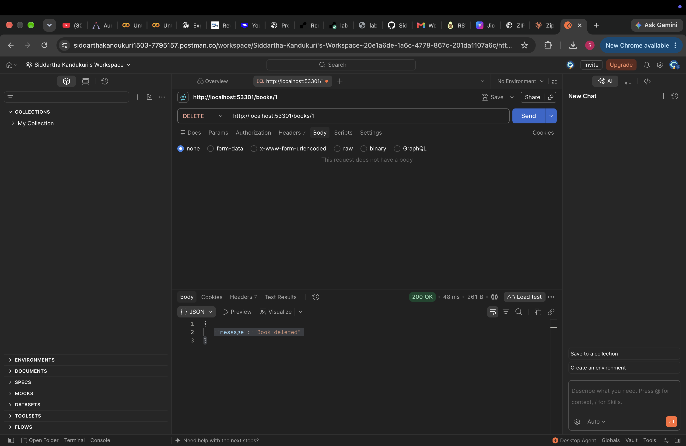
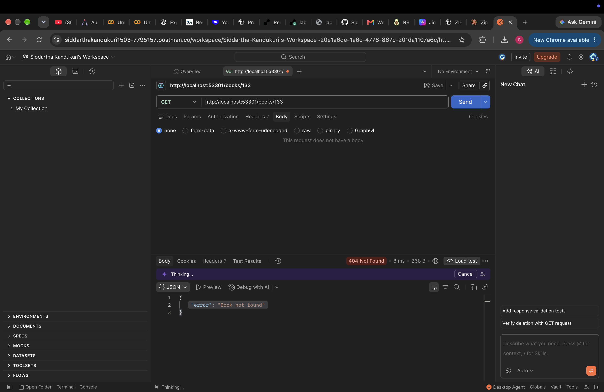
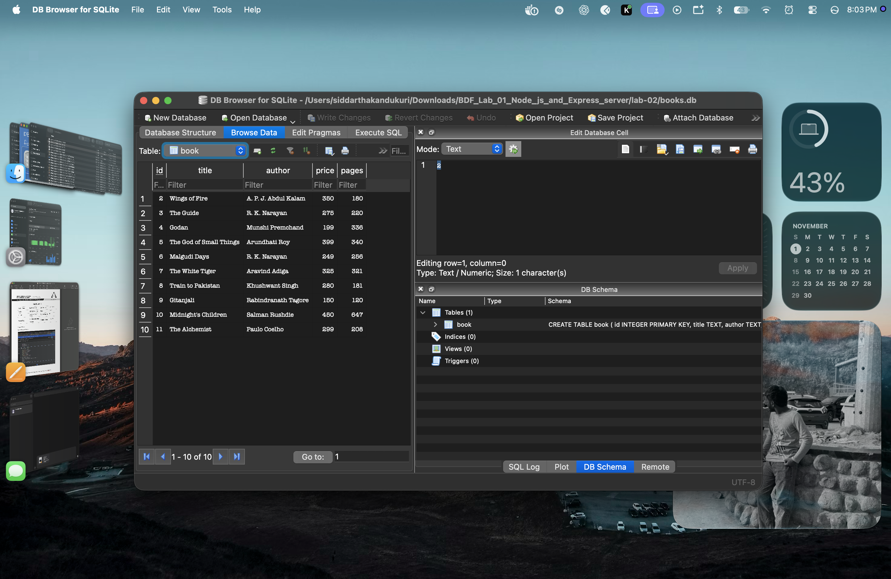

# Lab 2: SQLite database and CRUD routes

**Name:** YOUR NAME · **Registration number:** YOUR REG NO · **Section:** YOUR SECTION

**Live link:** PASTE PUBLIC URL HERE (or explain below why the project could not be deployed)

## How to run

```bash
cd lab-02
npm install
npm run dev     # nodemon, restarts on every change
# or: npm start
```

Environment variables (optional): `PORT` (default `3000`). No secrets are used in this lab.

The database file `books.db` is included. To recreate it:

```bash
rm books.db
sqlite3 books.db < seed.sql
```

## Endpoints

| Method | Path | Description |
| --- | --- | --- |
| GET | `/books/` | Return all books |
| GET | `/books/:bookId/` | Return one book (404 if missing) |
| POST | `/books/` | Add a book, returns `{ "bookId": n }` with 201 |
| PUT | `/books/:bookId/` | Update all fields of a book (404 if missing) |
| DELETE | `/books/:bookId/` | Delete a book (404 if missing) |

Request body for POST and PUT:

```json
{ "title": "Book title", "author": "Author name", "price": 299, "pages": 200 }
```

## Screenshots

Add your Postman and SQLite CLI screenshots to `screenshots/` and show them like this:








## Notes

Problems faced and how I solved them: WRITE HERE.
